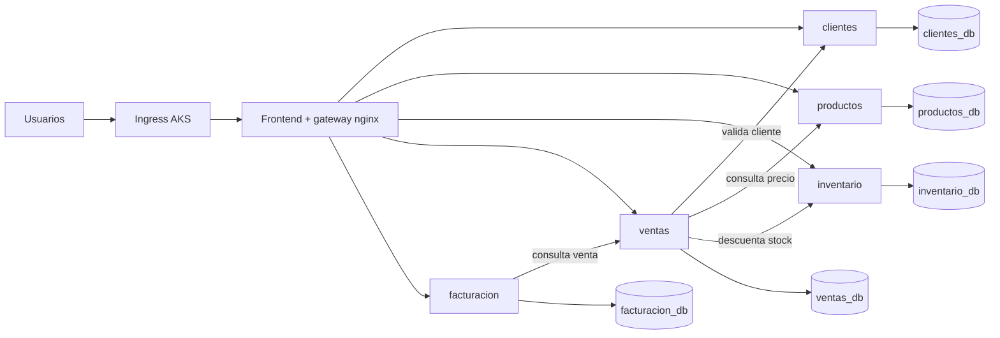

# Servicios Integrados S.A.S.

Plataforma de ventas basada en **microservicios**, empaquetada con **Docker**, orquestada con **Kubernetes (Azure Kubernetes Service)** y entregada con un pipeline **CI/CD en Azure DevOps**.

| Componente | Tecnología |
|---|---|
| Microservicios | Java 21, Spring Boot 4, Spring Data JPA, Bean Validation, Actuator |
| Base de datos | PostgreSQL (una base por microservicio); H2 en memoria para desarrollo y pruebas |
| Frontend | React + Vite, servido por nginx (que también actúa como gateway) |
| Contenedores | Docker (builds multietapa, usuario sin privilegios) |
| Orquestación | Kubernetes en AKS: sondas, límites de recursos, HPA, Ingress |
| CI/CD | Azure DevOps Pipelines + Azure Container Registry |

## Arquitectura



Cada microservicio es independiente: tiene su propio código, su propia base de datos y su propia imagen. Se comunican únicamente por HTTP.

### Flujo de una venta

1. **Ventas** valida que el cliente exista (Clientes) y obtiene nombre y precio de cada producto (Productos).
2. Descuenta las existencias en **Inventario**. Si una línea falla (por ejemplo, stock insuficiente), las unidades ya descontadas se devuelven automáticamente (compensación).
3. Guarda la venta con una copia del nombre y precio de cada producto, de modo que cambios posteriores en el catálogo no alteren el histórico.
4. **Facturación** emite la factura a partir de la venta (IVA configurable, 19 % por defecto), impide facturar dos veces la misma venta y marca la venta como facturada.

## Estructura del repositorio

```
.
├── microservicio-clientes/       Servicio de clientes (puerto local 8081)
├── microservicio-productos/      Catálogo y precios (8082)
├── microservicio-inventario/     Existencias y movimientos (8083)
├── microservicio-ventas/         Registro de ventas, orquesta a los demás (8084)
├── microservicio-facturacion/    Emisión de facturas (8085)
├── frontend/                     SPA en React + gateway nginx
├── kubernetes/                   Manifiestos de AKS
├── scripts/                      azure-setup.sh y deploy.sh
├── docker/postgres/init.sql      Creación de las bases de datos locales
├── docker-compose.yml            Plataforma completa en local
├── azure-pipelines.yml           Pipeline CI/CD
└── pom.xml                       Agregador Maven (compila los 5 servicios)
```

## Ejecución local

### Opción A: Docker Compose (toda la plataforma)

Requisitos: Docker con Compose v2.

```bash
cp .env.example .env        # define una contraseña propia para PostgreSQL
docker compose up --build
```

La aplicación queda disponible en <http://localhost:8080>.

### Opción B: desarrollo sin Docker

Requisitos: JDK 21, Maven 3.9+ y Node.js 22+. Los servicios usan H2 en memoria, así que no necesitas instalar una base de datos.

```bash
# Un terminal por servicio (ventas y facturación necesitan que sus dependencias estén arriba)
cd microservicio-clientes    && mvn spring-boot:run
cd microservicio-productos   && mvn spring-boot:run
cd microservicio-inventario  && mvn spring-boot:run
cd microservicio-ventas      && mvn spring-boot:run
cd microservicio-facturacion && mvn spring-boot:run

# Frontend con recarga en caliente (http://localhost:5173)
cd frontend && npm install && npm run dev
```

## Pruebas

```bash
mvn verify          # desde la raíz: ejecuta las pruebas de los cinco microservicios
```

Cada servicio incluye pruebas unitarias de la lógica de negocio (Mockito), pruebas de la capa web (MockMvc) y una prueba de arranque del contexto de Spring.

## API

Todos los errores siguen el formato RFC 9457 (`application/problem+json`). Los de validación incluyen el detalle por campo en `errores`.

| Servicio | Endpoints |
|---|---|
| Clientes | `GET/POST /api/clientes` · `GET/PUT/DELETE /api/clientes/{id}` |
| Productos | `GET/POST /api/productos` (`?soloActivos=true`) · `GET/PUT/DELETE /api/productos/{id}` |
| Inventario | `GET /api/inventario` · `GET /api/inventario/{productoId}` · `GET /api/inventario/{productoId}/movimientos` · `POST /api/inventario/{productoId}/entrada` · `POST /api/inventario/{productoId}/salida` |
| Ventas | `GET/POST /api/ventas` · `GET /api/ventas/{id}` · `PATCH /api/ventas/{id}/facturada` |
| Facturación | `GET/POST /api/facturas` · `GET /api/facturas/{id}` · `GET /api/facturas/venta/{ventaId}` |

Cada servicio expone además `/actuator/health`, `/actuator/health/liveness` y `/actuator/health/readiness`.

Ejemplo de venta completa. Los puertos 8081 a 8085 aplican al desarrollo sin Docker (opción B); con Docker Compose o en AKS todas las rutas se atienden por el gateway (por ejemplo `localhost:8080/api/clientes`).

```bash
curl -X POST localhost:8081/api/clientes -H 'Content-Type: application/json' \
  -d '{"nombre":"Ana Torres","documento":"1020304050","email":"ana@correo.com"}'
curl -X POST localhost:8082/api/productos -H 'Content-Type: application/json' \
  -d '{"sku":"LAP-001","nombre":"Portátil 14 pulgadas","precio":2500000}'
curl -X POST localhost:8083/api/inventario/1/entrada -H 'Content-Type: application/json' \
  -d '{"cantidad":10,"referencia":"COMPRA-001"}'
curl -X POST localhost:8084/api/ventas -H 'Content-Type: application/json' \
  -d '{"clienteId":1,"items":[{"productoId":1,"cantidad":2}]}'
curl -X POST localhost:8085/api/facturas -H 'Content-Type: application/json' -d '{"ventaId":1}'
```

## Configuración

| Variable | Servicio | Descripción | Valor por defecto |
|---|---|---|---|
| `SPRING_PROFILES_ACTIVE` | todos | `prod` activa PostgreSQL | (H2 en memoria) |
| `DB_URL`, `DB_USER`, `DB_PASSWORD` | todos | Conexión a la base (perfil `prod`) | obligatorias con `prod` |
| `DDL_AUTO` | todos | Estrategia de esquema de Hibernate | `update` |
| `SERVICIOS_CLIENTES_URL`, `SERVICIOS_PRODUCTOS_URL`, `SERVICIOS_INVENTARIO_URL` | ventas | URLs de las dependencias | `http://localhost:808x` |
| `SERVICIOS_VENTAS_URL` | facturación | URL de Ventas | `http://localhost:8084` |
| `SERVICIOS_TIMEOUT_MS` | ventas, facturación | Tiempo máximo de espera por llamada | `3000` |
| `FACTURACION_IVA_PORCENTAJE` | facturación | Porcentaje de IVA | `19` |

Ninguna credencial se guarda en el repositorio: llegan por variables de entorno (`.env` en local, Secret de Kubernetes en AKS).

## Despliegue en Azure

### 1. Infraestructura

```bash
az login
./scripts/azure-setup.sh
```

Crea el grupo de recursos, el Azure Container Registry y el clúster AKS (con el registro asociado y el Ingress administrado). Se puede personalizar con variables de entorno (`LOCATION`, `ACR_NAME`, `AKS_NAME`, `NODE_VM_SIZE`, etc.). El nombre del ACR debe ser único en Azure y solo admite minúsculas y números.

> Si usas una cuenta de estudiante, algunas regiones y tamaños de máquina pueden estar restringidos por política; ajusta `LOCATION` y `NODE_VM_SIZE` según lo permitido.

### 2. Secreto de base de datos

```bash
kubectl create namespace servicios-integrados
kubectl -n servicios-integrados create secret generic db-credentials \
  --from-literal=POSTGRES_USER=servicios \
  --from-literal=POSTGRES_PASSWORD='<contraseña segura>'
# Repetir para el namespace servicios-integrados-dev
```

### 3. Pipeline en Azure DevOps

1. Crea dos **service connections** (Project settings > Service connections): una de tipo *Azure Resource Manager* (`sc-azure`) y otra de tipo *Docker Registry* apuntando a tu ACR (`sc-acr`).
2. Crea los **environments** `servicios-integrados-dev` y `servicios-integrados-prod`. En el de producción agrega una **aprobación manual** (Approvals and checks).
3. Ajusta el bloque `variables` al inicio de `azure-pipelines.yml` (nombres de service connections, ACR, grupo de recursos y clúster).
4. Crea el pipeline apuntando a `azure-pipelines.yml`.

Comportamiento:

| Evento | Qué ocurre |
|---|---|
| Pull request a `main` o `develop` | Compila y ejecuta pruebas (no publica ni despliega) |
| Push a `develop` | Compila, prueba, publica imágenes y despliega en **dev** |
| Push a `main` | Lo anterior, y luego despliega en **producción** tras la aprobación |

### 4. Despliegue manual (opcional)

```bash
ACR_LOGIN_SERVER=<tu-acr>.azurecr.io IMAGE_TAG=<etiqueta> ./scripts/deploy.sh servicios-integrados
```

Aplica los manifiestos, espera a que los despliegues estén listos y ejecuta una prueba de humo contra `/actuator/health` de cada servicio. La IP pública se obtiene con `kubectl -n servicios-integrados get ingress`.

## Decisiones de diseño y puntos a considerar

- **Gateway:** el contenedor del frontend ejecuta nginx y enruta `/api/<módulo>` hacia cada microservicio. Para un caso de uso mayor se puede sustituir por Azure API Management.
- **Consistencia entre servicios:** no hay transacciones distribuidas. Ventas usa compensación explícita sobre Inventario; Facturación evita duplicados con una restricción única en base de datos.
- **Concurrencia:** Inventario bloquea la fila de existencias durante cada movimiento, de modo que dos ventas simultáneas no descuentan el mismo stock.
- **Esquema de base de datos:** el esquema lo crea Hibernate (`ddl-auto=update`) para simplificar. En un entorno productivo real conviene usar migraciones versionadas (Flyway o Liquibase) y `DDL_AUTO=validate`.
- **PostgreSQL en el clúster:** `kubernetes/postgres.yaml` es una instancia única pensada para pruebas. En producción se recomienda Azure Database for PostgreSQL.
- **Secretos:** en producción se recomienda sincronizar los secretos desde Azure Key Vault con el Secrets Store CSI Driver.
- **Políticas de red:** `kubernetes/opcional/network-policies.yaml` restringe el tráfico entrante; requiere que el clúster tenga un motor de políticas de red habilitado.
- **Observabilidad:** los servicios exponen sondas y métricas de Actuator. Para monitoreo en Azure se puede habilitar Container Insights en el clúster y Application Insights en las aplicaciones.
